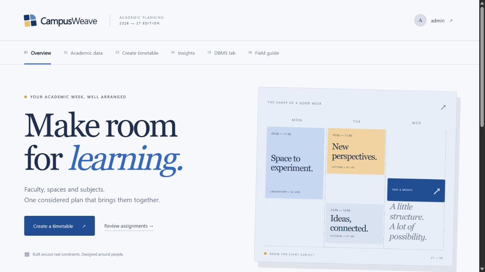

# CampusWeave

A faculty-friendly timetable planning studio with conflict-aware scheduling, a normalized MySQL database, MongoDB feedback, and an evidence-backed DBMS learning lab.



Navy, blue, ivory and gold give the workspace an academic editorial style. Faculty can maintain assignments, generate a draft, review each division, publish, export CSV and print a timetable without working with SQL directly.

## Run on the prepared Windows PC

Open `D:\Archit\Others\CampusWeave\Start-CampusWeave.cmd`. It starts the local databases and application, then opens **http://127.0.0.1:5050**.

Demo login: **admin / CampusDemo!2026**. This is a documented local demonstration account.

To stop the application and gracefully stop its local database servers:

```powershell
powershell -NoProfile -ExecutionPolicy Bypass -File .\Stop-CampusWeave.ps1
```

Local configuration and database files stay in `.env` and `runtime/`; neither is published. The prepared installation uses MySQL port 3307, MongoDB port 27018 and application port 5050, all bound to loopback. The source repository does not include database binaries or the Python environment.

## What works

- Academic catalog CRUD with eligibility, availability, room capacity and workload constraints.
- Bounded backtracking scheduler with contiguous practical sessions, separate-day repetitions and published reservations across semesters.
- Atomic publication, database validation, protected historical editions and automatic audit history.
- Weekly division timetable, CSV export, print layout and published-only workload/room insights.
- Live transaction/savepoint lab, MongoDB feedback CRUD and aggregation, and an idempotent star-schema warehouse with OLAP ROLLUP.
- Executable normalization, serializability, recovery, fragmentation and parallel aggregation teaching experiments.
- Oracle PL/SQL procedures, functions, six cursor variants and row/statement/compound/INSTEAD OF triggers, verified on Oracle 21c.

## Evaluation materials

| Material | Where to look |
| --- | --- |
| All six grading rubrics | [Rubric evidence map](docs/RUBRIC_COVERAGE.md) |
| Combined report and syllabus workbook | [PDF report](docs/CampusWeave_Report.pdf) |
| Requirements, design, normalization, demo and viva | [Editable report](docs/PROJECT_REPORT.md) |
| Every supplied syllabus topic and all ten labs | [Syllabus workbook](docs/SYLLABUS_WORKBOOK.md) |
| Complete ER, PK/FK/UK and cardinalities | [Complete ER](docs/ER_complete.svg), [overview](docs/ER_overview.svg), [dictionary](docs/schema_dictionary.json) |
| Application and warehouse architecture | [Architecture](docs/architecture.svg), [star schema](docs/ER_warehouse.svg) |
| Test results and reproducibility | [Verification](docs/VERIFICATION.md) |
| Actual Oracle execution | [Oracle 21c results](https://dbfiddle.uk/x6YRxBnX), [saved transcript](docs/oracle_execution.md) |

The operational schema contains 15 physical tables, including the scheduling lock; the warehouse adds five. A session header owns its room and day, with separate period allocations. `timetable_entries` is a flattened read view, not a duplicated physical relation.

## Fresh-machine setup

Requires Python 3.11 or later, MySQL 8.4 and MongoDB 8.0. The current evidence was collected with MySQL 8.4.13 and MongoDB 8.0.29. Install database servers from their official distributions and start them locally with authentication enabled. The Windows launcher can also use the prepared project-local runtime; fresh clones normally use separately installed servers.

```powershell
python -m venv .venv
.\.venv\Scripts\python.exe -m pip install -r requirements.txt
Copy-Item .env.example .env
```

Create the schema with an administrative MySQL account. `setup_db.py` refuses to overwrite an existing schema. Supply the admin password in your shell environment, not in source control:

```powershell
$env:DB_HOST='127.0.0.1'
$env:DB_PORT='3307'
$env:DB_ADMIN='root'
# Set DB_ADMIN_PASSWORD privately in this shell before running the next command.
.\.venv\Scripts\python.exe scripts/setup_db.py --database campusweave
```

Create a dedicated MySQL application user, then grant only `SELECT, INSERT, UPDATE, DELETE, EXECUTE` on `campusweave.*`. Put that user's credentials, server port and a long random `FLASK_SECRET_KEY` in `.env`. The setup account owns stored objects and must remain available as their definer. A narrowly scoped definer procedure exposes trigger names/events to the app without granting trigger administration.

For MongoDB, create a `campus_mongo` user in database `campusweave` with the `readWrite` role on that database. Set `MONGO_URI` with its URL-encoded password and `authSource=campusweave`; set `MONGO_DB=campusweave`. Core scheduling uses MySQL; the feedback lab needs MongoDB.

```powershell
.\.venv\Scripts\python.exe app.py
```

Open http://127.0.0.1:5050. Seeded catalog records are synthetic. Generate a timetable to populate the planner; publish before reviewing insights or loading the warehouse. Use semester 5 for another cohort after publishing semester 3, or archive the active edition before generating a replacement for its scope.

## Reproduce verification

```powershell
.\.venv\Scripts\python.exe -m pip install -r requirements-dev.txt
.\.venv\Scripts\python.exe -m pytest -q
.\.venv\Scripts\python.exe scripts/sql_experiments.py
.\.venv\Scripts\python.exe scripts/mongo_experiments.py
.\.venv\Scripts\python.exe scripts/course_experiments.py
.\.venv\Scripts\python.exe scripts/benchmark.py
```

Tests create and remove uniquely named test databases, leaving application data intact. The prepared PC reads ignored local admin credentials. On another PC set `DB_ADMIN_PASSWORD` and `TEST_DB_PORT` (default 3307); the Mongo test expects an administrative user named `campus_admin` at port 27018, with `MONGO_ADMIN_PASSWORD`. The standalone SQL/Mongo benchmark scripts accept these same administrative password variables and otherwise read the prepared installation's ignored credential files. Do not point tests at a shared production server.

Oracle reruns are optional: `scripts/verify_oracle.py --accept-cc0` sends only the generated teaching scripts to db<>fiddle under CC0. The saved result is already verified; Oracle is not needed to run the main application.

To rebuild the PDF, install development requirements and run `scripts/build_report.py`. Windows Arial/Georgia fonts are used when present; the script falls back to ReportLab fonts. Diagram regeneration requires Graphviz: `scripts/build_diagrams.py PATH_TO_DOT_EXE`.

## Scope

This is a local academic project, not an internet-hosted campus service. Fixed one-hour periods, six teaching days and one teacher per offering are modeled. The solver seeks feasibility within a bounded search; it does not claim global optimality. Hadoop/HDFS, CAP and distributed recovery examples are explicitly labeled teaching models; no Hadoop or distributed database cluster is claimed. MongoDB's legacy MapReduce is demonstrated for syllabus compatibility, alongside its aggregation pipeline.

The project supplies evidence for every rubric. Viva performance and the institution's assessment remain part of the final marks.
